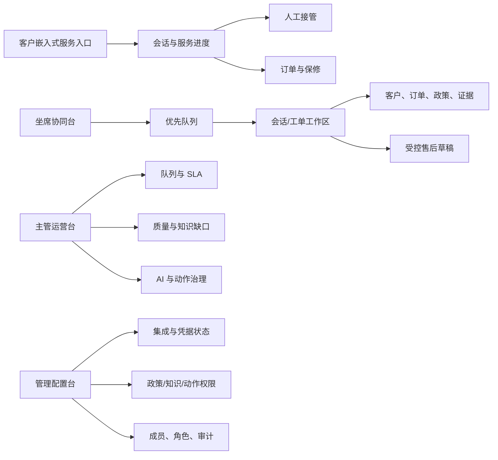
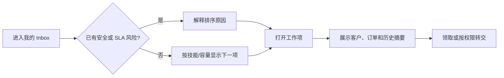
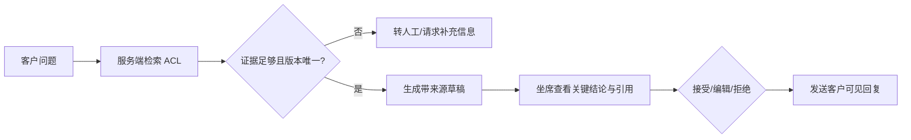
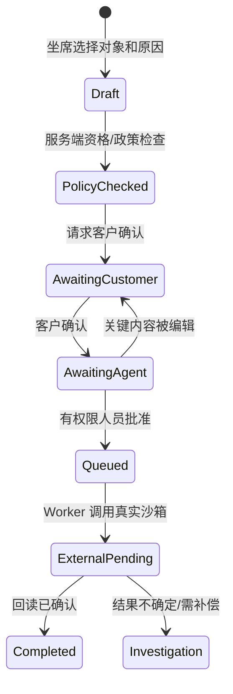
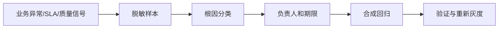

# 产品化信息架构与关键任务原型

- 阶段：步骤 41.5 / PZ-1
- 状态：设计基线，待真实用户验证
- 目标：让每个角色只看到完成当前任务所需的上下文、证据和动作

## 现状问题

当前顶栏同时暴露客户、坐席和主管入口，Demo 身份由浏览器切换；坐席页把人工升级、工单、
知识回答、售后、状态、回复和时间线纵向组合；主管页又把队列、QA 和 Trace 放在同一长页。
这些结构适合验证 API 覆盖，不适合日常操作。

产品化架构执行四条规则：

1. 按角色提供独立 App Shell，不把角色切换当作导航。
2. 按任务组织信息，不按开发步骤或后端模块组织。
3. 主任务在中心，证据和客户/订单上下文邻近显示，治理信息按需下钻。
4. “建议、草稿、已确认、已批准、已执行”必须是不同视觉和文案状态。

## 四个产品表面



### 客户嵌入式服务入口

建议路由（产品实现时可由宿主应用嵌入）：

| 路由 | 任务 | 首屏必须回答 |
|---|---|---|
| `/help` | 发起服务、继续最近会话 | 我能做什么、是否在线、会不会转人工 |
| `/help/conversations/{id}` | 对话并查看服务状态 | 当前由 AI 还是人工处理、下一步是什么 |
| `/help/orders/{ref}` | 查询本人订单、履约、保修 | 这是我的订单吗、状态和可用动作是什么 |
| `/help/cases/{id}` | 查看售后申请 | 草稿/待确认/待审批/已提交/失败的准确状态 |

不展示内部风险码、路由名、R0/R1/R2、Trace、模型名或开发步骤。品牌名、语气、颜色和帮助
渠道由租户配置，但风险文案和确认语义不能被品牌配置改写。

### 坐席协同台

建议路由：

| 路由 | 任务 |
|---|---|
| `/agent/inbox` | 我的、未分配、即将超 SLA、安全升级等可保存视图 |
| `/agent/inbox/{work_id}` | 在一个工作区理解问题、回复、升级或创建受控动作 |
| `/agent/customers/{id}` | 只读客户、设备/序列号、订单和历史服务摘要 |
| `/agent/tasks` | 等待客户确认、等待审批、外部处理中和补偿待处理任务 |

桌面采用三栏主结构，避免坐席在多个纵向模块间寻找主动作：

```text
┌──────────────┬────────────────────────────────────┬──────────────────────┐
│ 队列 / 筛选  │ 会话与当前任务                     │ 客户与业务上下文     │
│              │                                    │                      │
│ 安全升级  2  │ 客户问题 + 关键事件                │ 客户/设备/订单       │
│ 即将超时  7  │                                    │ 履约/保修状态        │
│ 我的处理 18  │ [证据充分度] [政策版本]             │ 风险与同意状态       │
│              │ AI 建议 / 引用 / 人工编辑           │                      │
│ 工单列表     │                                    │ 下一最佳动作         │
│ SLA / 意图   │ 回复编辑器 / 售后步骤条             │ [查看证据] [发起草稿]│
└──────────────┴────────────────────────────────────┴──────────────────────┘
```

窄屏不简单缩成三列：队列、会话、上下文变为三个可保留状态的视图；高风险确认在移动端仍须展示
完整对象、影响和撤销/补偿说明。

### 主管运营台

建议路由：

| 路由 | 任务 |
|---|---|
| `/ops/overview` | 当前积压、SLA 风险、AI/人工分布和异常提醒 |
| `/ops/queues` | 队列容量、分配、技能和升级处理 |
| `/ops/quality` | 抽检、错误类型、知识缺口和修复验证 |
| `/ops/ai-governance` | 灰度、版本、动作权限、成本和安全事件 |
| `/ops/incidents/{id}` | 从业务事件下钻到脱敏 Trace，而不是直接浏览原始 span |

主管首页只展示可采取行动的运营信号。Trace ID、模型版本和技术 span 位于事件详情的“技术证据”
页签，并保留当前最小化/脱敏约束。

### 管理配置台

建议路由：

| 路由 | 任务 |
|---|---|
| `/admin/integrations` | 帮助台、OMS、身份和通知渠道连接状态 |
| `/admin/policies` | 产品/地区/渠道政策和动作审批规则 |
| `/admin/knowledge` | 来源、版本、发布、撤回和知识缺口 |
| `/admin/access` | 成员、角色、队列资格和服务账户 |
| `/admin/audit` | 筛选和导出经过权限控制的审计摘要 |

配置变更和一线处理分离。需要双人控制或高风险权限的配置不得隐藏在主管日常工作页。

## 六条关键任务流

### 1. 领取最需要处理的工作



成功条件：坐席不需要先理解内部队列名；领取前能看到风险、SLA 和所需技能，不能看到其他租户。

### 2. 基于可验证来源回复



成功条件：引用与对应结论邻近显示；“接受”不等于“事实已验证”；发送前明确客户可见范围。

### 3. 订单与保修判断

候选订单号只用于查找。服务端从可信身份/客户映射绑定租户和 Shopify customer/order 关系；
UI 不提交 `tenant_id`、`customer_id` 或 Shopify GID。未找到和不属于当前客户仍使用相同结果。

成功条件：坐席和客户只看到任务需要的订单、履约、设备/序列号与保修字段；敏感地址和电话默认
隐藏，确有任务需要时再按权限揭示。

### 4. 创建受控 RMA/退货草稿



每一步显示“谁完成、何时完成、基于哪个政策版本、下一位责任人”。外部系统未回读确认前不得显示
“已完成”。

### 5. 安全/投诉升级

检测到产品安全、人身风险、数据泄露、威胁或严重投诉时，主动作切换为“保护现场并升级”；隐藏
不适用的自动售后按钮，但保留原始工单的可追溯引用。主管看到明确 SLA、目标队列和缺失信息。

成功条件：坐席不能把安全事件误关为普通 FAQ；不得让模型选择降低风险等级。

### 6. 主管从异常到修复



成功条件：主管从业务问题进入技术证据，而不是从原始 Trace 猜业务影响；重新开启自动化需要独立
授权，不能由关闭问题的同一个快捷动作完成。

## 关键屏幕内容优先级

### 坐席工作项中心栏

1. 客户当前问题、渠道、等待时间和风险状态。
2. 最近相关消息与系统事件，不混排内部备注和客户消息。
3. 当前建议/草稿及证据充分度。
4. 回复或受控动作的唯一主 CTA。
5. 完成后的下一步和责任人。

### 右侧上下文栏

1. 客户和验证状态。
2. 当前订单、设备/序列号、履约和保修。
3. 政策版本、适用地区和引用。
4. 售后确认/审批/外部回执步骤。
5. 完整历史和审计按需展开。

## 原型与实现边界

可点击静态原型位于
[`prototypes/careops-console.html`](prototypes/careops-console.html)，用于验证信息层级、任务流和
设计 token，不调用 API，也不证明权限、安全或供应商契约。真实页面迁移必须继续复用服务端授权，
不能把原型中的显示/隐藏当作权限控制。
